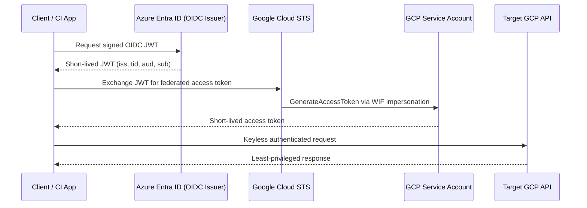

# Enterprise Identity Federation: Entra ID to Google Cloud

> Status: initial reference implementation, not production certified. Live Entra-to-GCP exchange has not been validated. The Entra module currently exposes existing application identifiers; it does not provision app registrations, scopes, or enterprise applications. Automated token acquisition and complete integration tests remain follow-up work. Review and test the trust configuration in a non-production environment before deployment.

Production-oriented reference implementation for keyless, least-privilege federation from Microsoft Entra ID to Google Cloud using Workload Identity Federation (WIF). It is designed for a CI workload that receives an Entra OIDC token, exchanges it at Google Security Token Service (STS), and impersonates a narrowly scoped Google service account.

## Security posture

- No service-account JSON keys, client secrets, or long-lived cloud credentials are committed or required.
- Entra issuer, tenant, audience, subject, and token type are constrained by the GCP provider and IAM principal mapping.
- The federated identity can impersonate only the purpose-built service account; that account receives only the required resource role.
- STS and service-account credentials are short-lived and auditable. Set `access_token_lifetime_seconds` no higher than the workload needs.
- The design supports SOC 2 CC6/CC7 evidence (access restriction, authentication, monitoring) and ISO 27001 A.5/A.8/A.9 evidence (identity lifecycle, asset/access control, authentication).

## Architecture



## Prerequisites

Azure CLI, Google Cloud CLI, Terraform >= 1.6, Python 3.11+, Bash, and `gcloud auth application-default login` for the operator who applies Terraform. The runtime workload itself does not use those operator credentials.

## Setup

1. Select subscriptions/projects and authenticate:

```bash
az login
az account set --subscription "$AZURE_SUBSCRIPTION_ID"
gcloud auth login
gcloud config set project "$GCP_PROJECT_ID"
gcloud services enable iamcredentials.googleapis.com sts.googleapis.com storage.googleapis.com iam.googleapis.com
```

2. Create an Entra application and record its application/client ID. For a CI runner, configure a federated credential or use the platform's OIDC endpoint to obtain a token. The exchange script expects `AZURE_OIDC_TOKEN`; in CI, populate it from the runner's signed OIDC token mechanism rather than a static secret.

```bash
az ad app create --display-name enterprise-identity-federation-entra-gcp
az ad sp create --id "$AZURE_CLIENT_ID"
```

3. Copy and edit Terraform inputs:

```bash
cp terraform/terraform.tfvars.example terraform/terraform.tfvars
terraform -chdir=terraform init
terraform -chdir=terraform fmt -check -recursive
terraform -chdir=terraform validate
terraform -chdir=terraform plan -var-file=terraform.tfvars
terraform -chdir=terraform apply -var-file=terraform.tfvars
```

4. Run the keyless exchange after Terraform outputs are available:

```bash
# Supply a short-lived Entra JWT matching this provider's issuer and audience.
# A token issued for an unrelated Azure resource will not work.
export AZURE_OIDC_TOKEN
export GCP_PROJECT_ID GCP_SERVICE_ACCOUNT_EMAIL
export GCP_WORKLOAD_PROVIDER="$(terraform -chdir=terraform output -raw workload_identity_provider_name)"
export GOOGLE_OAUTH_ACCESS_TOKEN="$(bash scripts/exchange-token.sh)"
python3 scripts/test-permissions.py
```

> Token acquisition must be configured for the Entra application. A CI platform's own OIDC token is not an Entra-issued JWT. Never store JWTs in source control.

## CI and teardown

The GitHub workflow runs Terraform validation and tfsec on every change, plus an opt-in exchange smoke test. Set repository variables `GCP_WORKLOAD_PROVIDER`, `GCP_SERVICE_ACCOUNT_EMAIL`, and `ENABLE_FEDERATION_SMOKE_TEST=true`, and inject `AZURE_OIDC_TOKEN` only as a short-lived Actions secret at runtime. The token must be issued by the configured Entra tenant; the workflow never treats GitHub's own OIDC issuer as Entra.

```bash
./scripts/destroy.sh terraform/terraform.tfvars
```

Teardown requires `CONFIRM_DESTROY=I_UNDERSTAND` and runs a plan before apply.

## Repository layout

`terraform/modules/azure_entra_id` models the Entra application/service principal contract; `terraform/modules/gcp_workload_id` creates the WIF pool/provider, service account, and binding; `terraform/environments/prod` composes them. See [docs/oidc-sequence.md](docs/oidc-sequence.md) for claim-level details.

## License

MIT. See [LICENSE](LICENSE).
